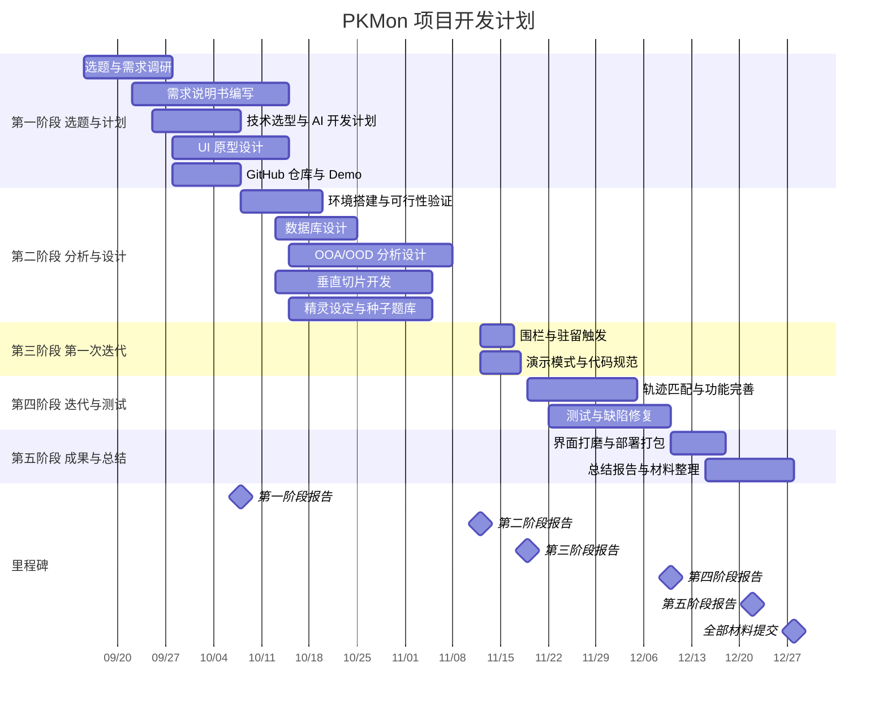

# PKMon 项目开发计划甘特图

| 文档版本 | v1.1 |
|---|---|
| 编写日期 | 2026-10-05 |
| 编写人 | 【协调/产品】 |
| 计划周期 | 2026-09-15 – 2026-12-28 |

> 本图按阶段汇总，共 16 项任务。细分子任务在 GitHub Issues（Backlog）中管理，不在此图体现。
> 甘特图使用 **Gantt Project** 或 **MS Project** 绘制，任务数据取自第 2 节任务表。

---

## 1 甘特图

---

## 2 任务表

| ID | 任务名称 | 开始 | 结束 | 责任人 | 前置任务 | 交付物 |
|---|---|---|---|---|---|---|
| a1 | 选题与需求调研 | 09-15 | 09-28 | 协调/产品 | — | 选题说明 |
| a2 | 需求说明书编写 | 09-22 | 10-15 | 协调/产品 | a1 | 软件需求说明书 |
| a3 | 技术选型与 AI 开发计划 | 09-25 | 10-08 | 服务端·基建 | a1 | 技术选型说明、AI 辅助开发计划 |
| a4 | UI 原型设计 | 09-28 | 10-15 | UI/美术 | a1 | UI 设计稿 |
| a5 | GitHub 仓库与 Demo 开发 | 09-28 | 10-08 | 服务端·基建、客户端·定位 | — | 仓库、可运行 Demo |
| b1 | 环境搭建与可行性验证 | 10-08 | 10-20 | 服务端·基建、客户端·定位 | a5 | 可运行工程骨架 |
| b2 | 数据库设计 | 10-13 | 10-25 | 服务端·基建 | b1 | 建表 SQL |
| b3 | OOA/OOD 分析设计 | 10-15 | 11-08 | 服务端·业务、客户端·业务 | b2 | 分析设计文档 |
| b4 | 垂直切片开发 | 10-13 | 11-05 | 客户端 2 人、服务端·业务 | b2 | 可演示版本 |
| b5 | 精灵设定与种子题库 | 10-15 | 11-05 | 协调/产品 | a2 | 题库数据 |
| c1 | 围栏与驻留触发 | 11-12 | 11-17 | 服务端·算法、客户端·定位 | b4 | 可用功能 |
| c2 | 演示模式与代码规范 | 11-12 | 11-18 | 客户端·定位、服务端·基建 | b4 | 可用功能、代码规范 |
| d1 | 轨迹匹配与功能完善 | 11-19 | 12-05 | 服务端·算法、客户端·业务 | c1 | 可用功能 |
| d2 | 测试与缺陷修复 | 11-22 | 12-10 | 测试与质量（全员配合） | c1、c2 | 测试分析报告 |
| e1 | 界面打磨与部署打包 | 12-10 | 12-18 | UI/美术、服务端·基建 | d2 | `.apk`、服务端部署包 |
| e2 | 总结报告与材料整理 | 12-15 | 12-28 | 协调/产品 | d2 | 总结报告、最终提交包 |

---

## 3 里程碑

| 里程碑 | 日期 | 验收内容 |
|---|---|---|
| 第一阶段报告 | 2026-10-08 | 选题、开发计划、需求描述、AI 工作流、技术选型 + Demo |
| 第二阶段报告 | 2026-11-12 | OOA/OOD 文档；至少 1 个核心功能可演示 |
| 第三阶段报告 | 2026-11-19 | 第一次迭代，核心功能 ≥ 60% |
| 第四阶段报告 | 2026-12-10 | 第二次迭代与测试，核心功能 ≥ 80% |
| 第五阶段报告 | 2026-12-22 | 总体成果展示 |
| 全部材料提交 | 2026-12-28 | 安装包、文档、PPT、仓库链接 |

**各阶段文档截止**：10-15、11-19、11-26、12-17、12-27。

---

## 4 制作说明

1. 使用 Gantt Project（免费）或 MS Project 新建项目，起始日期设为 2026-09-15。
2. 按第 2 节任务表逐行录入任务名称、开始与结束日期。
3. 填写「前置任务」字段，工具会自动绘制依赖箭头，并在修改日期时自动顺延后续任务。
4. 五个阶段分别设置不同颜色；里程碑任务工期设为 0，会自动显示为菱形。
5. 导出 PDF 与 PNG 各一份，插入《软件项目开发计划》第 6.3 节。
6. 后续各阶段需提交「甘特图执行情况」：在原图上标注实际开始 / 完成时间与偏差，**不要重画新图**。

---

*文档结束*
