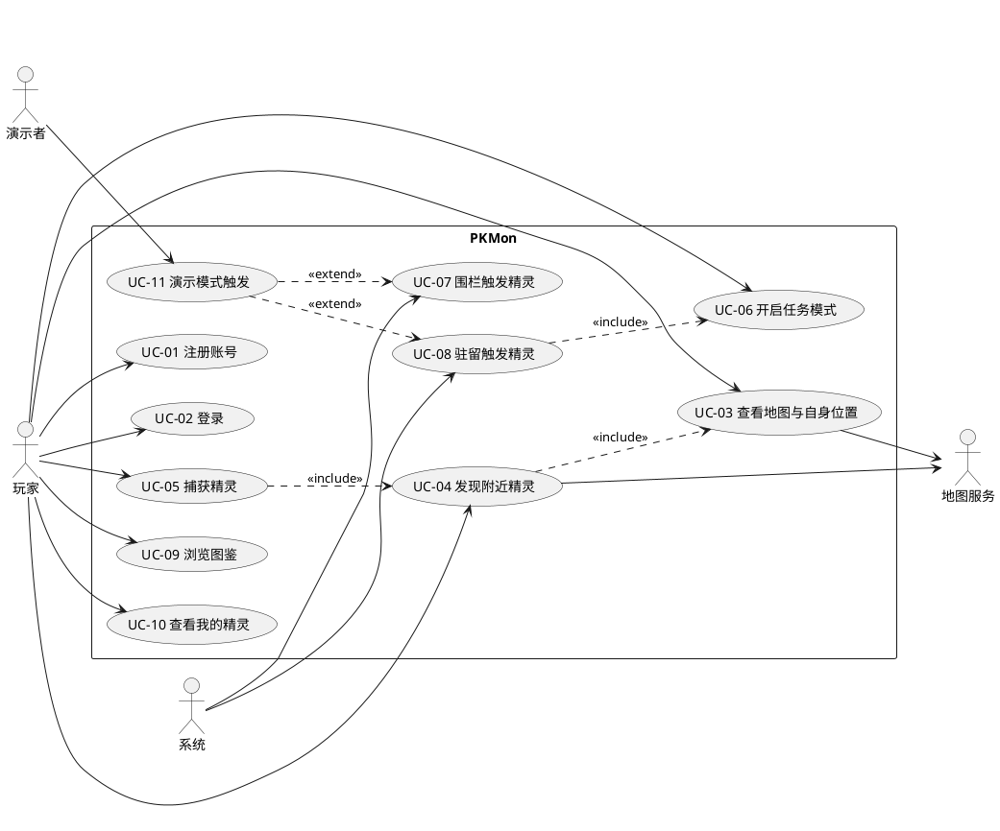

# PKMon 软件需求说明书

| 文档名称 | PKMon 软件需求说明书 |
|---|---|
| 文档版本 | v1.0 |
| 编写日期 | 2026-10-05 |
| 编写人 | 【协调/产品】 |
| 审核人 | 【全体组员】 |
| 适用阶段 | 第一阶段（9/15 – 10/8），提交截止 2026-10-15 |

> 本文档章节结构依据课程提供的《软件需求说明书》模板编写。

---

## 1 引言

> 课程提供的模板中说明：「在课程实践中，引言部分可不必填写」。本组保留极简版本。

本文档描述 PKMon 系统要实现的软件功能与非功能需求，作为分析设计、编码实现与测试验收的共同依据。预期读者为项目组全体成员及课程任课教师、助教。

---

## 2 项目概述

### 2.1 软件系统描述

**开发意图**

校园内分布着大量具有文化价值的地标与院系建筑，但缺少低门槛、有吸引力的传播载体；新生与访客对校园空间缺少结构化认知；学生的日常运动（上课、自习、跑步）缺乏即时正向反馈。PKMon 将校园探索、校园知识问答与运动习惯结合，以游戏化方式解决上述问题。

**应用目标**

开发一款面向高校学生的校园 LBS 收集类移动应用，实现以下目标：

1. 玩家可在真实校园地图上移动，并发现出现在地图上的校园精灵；
2. 精灵的出现由地理围栏、驻留时长、运动轨迹三类条件触发；
3. 玩家通过回答校园知识题捕获精灵，捕获结果计入图鉴与背包；
4. 系统支持在校园内实际使用，并可通过演示模式在教室环境中完整展示。

**作用范围**

- 客户端限定为 Android 平台；iOS 因后台定位策略差异较大，不在本期范围。
- 系统为校园范围内的单机联网应用，用户规模按课程演示规模设计。
- 系统不上架应用商店，不涉及正式运营与商业化。

**背景材料**

- 产品玩法与界面细节见《PKMon 游戏设计文档》；
- 项目目标、范围、人员与进度见《PKMon 软件项目开发计划》；
- AI 辅助开发的方式与规范见《PKMon AI 辅助开发计划》。

### 2.2 用户群体

| 用户类型 | 特征 | 教育水平与技术专长 | 使用频度 |
|---|---|---|---|
| 在校学生（主要用户） | 熟悉校园空间，日常在校园内移动；对校园知识有一定基础；使用智能手机熟练 | 本科及以上在读；能独立完成应用安装、权限授予与账号注册等常规操作 | 低频短时。单次 10–60 分钟，通常与步行、自习或运动同时进行；每周 1–3 次 |
| 新生与访客（次要用户） | 对校园空间不熟悉，需要导览 | 同上 | 偶发使用，通常在入学或访问期间集中使用 |
| 课堂演示者（特殊用户） | 由项目组成员担任，需在教室环境中展示系统功能 | 具备系统操作与排障能力 | 各阶段课堂报告时使用 |

**维护人员**：由项目组成员兼任，具备 Flutter 与 Spring Boot 开发能力，负责部署、配置与故障排查。

### 2.3 功能描述

#### 2.3.1 用况图



> 用况图源码为标准 PlantUML，可使用 VS Code 的 PlantUML 插件或 plantuml.com 渲染为图片后插入本文档。最终提交版本以图片形式呈现。

#### 2.3.2 用况说明

**UC-01 注册账号**

| 项目 | 内容 |
|---|---|
| 用况编号 | UC-01 |
| 用况名 | 注册账号 |
| 作者 | 【姓名】 |
| 用况描述 | 未注册用户创建新账号并进入系统 |
| 执行者 | 未注册用户 |
| 相关用况 | UC-02 登录 |
| 前置条件 | 用户已安装并打开应用，当前处于未登录状态 |
| 后置条件 | 系统中创建新账号，用户处于登录状态并进入地图主界面 |
| 基本路径 | 1. 用户选择「注册」；2. 输入用户名与密码并提交；3. 系统校验用户名未被占用且密码符合规则；4. 系统创建账号；5. 系统返回登录凭证；6. 客户端保存登录态并进入地图主界面 |

**UC-02 登录**

| 项目 | 内容 |
|---|---|
| 用况编号 | UC-02 |
| 用况名 | 登录 |
| 作者 | 【姓名】 |
| 用况描述 | 已注册用户通过账号密码登录系统 |
| 执行者 | 已注册用户 |
| 相关用况 | UC-01 注册账号 |
| 前置条件 | 用户已注册账号 |
| 后置条件 | 客户端保存登录态，用户进入地图主界面 |
| 基本路径 | 1. 用户输入用户名与密码；2. 提交登录请求；3. 系统校验账号密码；4. 校验通过后返回登录凭证；5. 客户端保存登录态并进入地图主界面 |

**UC-03 查看地图与自身位置**

| 项目 | 内容 |
|---|---|
| 用况编号 | UC-03 |
| 用况名 | 查看地图与自身位置 |
| 作者 | 【姓名】 |
| 用况描述 | 展示二维地图、玩家当前位置与感知半径 |
| 执行者 | 玩家 |
| 相关用况 | UC-04 发现附近精灵 |
| 前置条件 | 用户已登录；已授予精确定位权限 |
| 后置条件 | 地图以玩家位置为中心显示，并绘制感知半径 |
| 基本路径 | 1. 用户进入地图主界面；2. 客户端检查并申请定位权限；3. 通过地图 SDK 获取当前位置；4. 地图视角居中于玩家位置并显示位置标记；5. 以玩家为中心绘制半透明感知半径 |

**UC-04 发现附近精灵**

| 项目 | 内容 |
|---|---|
| 用况编号 | UC-04 |
| 用况名 | 发现附近精灵 |
| 作者 | 【姓名】 |
| 用况描述 | 感知半径内的精灵以自身形象渲染在地图上 |
| 执行者 | 玩家 |
| 相关用况 | UC-03 查看地图与自身位置；UC-05 捕获精灵 |
| 前置条件 | 地图主界面已加载；定位可用 |
| 后置条件 | 感知半径内的精灵显示在地图对应经纬度上 |
| 基本路径 | 1. 客户端按自适应频率上报当前位置；2. 服务端按位置查询感知半径内的精灵；3. 服务端返回精灵列表及其经纬度；4. 客户端在地图对应位置渲染精灵形象 |

**UC-05 捕获精灵**

| 项目 | 内容 |
|---|---|
| 用况编号 | UC-05 |
| 用况名 | 捕获精灵 |
| 作者 | 【姓名】 |
| 用况描述 | 通过回答校园知识题捕获地图上的精灵。备选路径：答错时精灵逃跑或进入冷却；请求超时不消耗机会；精灵已消失时提示并返回 |
| 执行者 | 玩家 |
| 相关用况 | UC-04 发现附近精灵 |
| 前置条件 | 地图上存在可点击的精灵 |
| 后置条件 | 答对时该精灵写入用户图鉴与背包，并记录捕获时间与地点 |
| 基本路径 | 1. 用户点击地图上的精灵；2. 客户端进入全屏抓捕界面；3. 服务端按该精灵的标签随机抽取一道启用状态的题目下发（不含答案）；4. 用户选择选项并提交；5. 服务端校验答案；6. 答对时返回捕获成功并写入图鉴与背包；7. 客户端播放捕获动效后返回地图主界面 |

**UC-06 开启任务模式**

| 项目 | 内容 |
|---|---|
| 用况编号 | UC-06 |
| 用况名 | 开启任务模式 |
| 作者 | 【姓名】 |
| 用况描述 | 用户主动开启持续定位状态，用于自习或跑步场景下的驻留与轨迹判定 |
| 执行者 | 玩家 |
| 相关用况 | UC-08 驻留触发精灵 |
| 前置条件 | 用户已登录并授予定位权限 |
| 后置条件 | 前台服务启动，常驻通知显示，位置采集频率提高；任务结束后自动停止 |
| 基本路径 | 1. 用户点击「开启任务模式」；2. 选择模式（自习 / 跑步）；3. 系统申请后台定位与通知权限；4. 启动前台服务并显示常驻通知；5. 客户端在地图顶部显示任务状态条与已持续时长 |

**UC-07 围栏触发精灵**

| 项目 | 内容 |
|---|---|
| 用况编号 | UC-07 |
| 用况名 | 围栏触发精灵 |
| 作者 | 【姓名】 |
| 用况描述 | 系统依据玩家位置与预设地理围栏的关系触发对应精灵 |
| 执行者 | 系统 |
| 相关用况 | UC-04 发现附近精灵 |
| 前置条件 | 玩家位置持续上报中；服务端已配置围栏及其对应精灵 |
| 后置条件 | 满足触发条件的精灵进入玩家可见状态 |
| 基本路径 | 1. 服务端接收并过滤异常位置点；2. 判定位置点是否落入围栏多边形；3. 采用缓冲策略，连续两次命中方确认状态切换，避免边界抖动；4. 状态由外向内切换时触发对应精灵；5. 通知客户端渲染该精灵 |

**UC-08 驻留触发精灵**

| 项目 | 内容 |
|---|---|
| 用况编号 | UC-08 |
| 用况名 | 驻留触发精灵 |
| 作者 | 【姓名】 |
| 用况描述 | 系统依据玩家在围栏内的连续停留时长触发对应精灵 |
| 执行者 | 系统 |
| 相关用况 | UC-06 开启任务模式；UC-07 围栏触发精灵 |
| 前置条件 | 玩家已开启任务模式；玩家当前位于目标围栏内 |
| 后置条件 | 驻留计时达到设定时长后触发对应精灵 |
| 基本路径 | 1. 玩家进入围栏后，服务端启动驻留计时；2. 客户端按心跳周期（3–5 分钟）上报位置；3. 服务端更新该用户的最后心跳时间；4. 驻留时长达到设定值且位置仍在围栏内时触发精灵；5. 若心跳断连超过阈值或最新位置已离开围栏，则驻留任务中断、计时清零 |

**UC-09 浏览图鉴**

| 项目 | 内容 |
|---|---|
| 用况编号 | UC-09 |
| 用况名 | 浏览图鉴 |
| 作者 | 【姓名】 |
| 用况描述 | 查看全部精灵的收集情况 |
| 执行者 | 玩家 |
| 相关用况 | UC-05 捕获精灵 |
| 前置条件 | 用户已登录 |
| 后置条件 | 展示收集进度与精灵列表 |
| 基本路径 | 1. 用户进入图鉴页面；2. 服务端返回已捕获精灵列表与精灵总数；3. 已捕获条目显示立绘与编号，未捕获条目显示剪影；4. 顶部展示收集进度与百分比；5. 用户点击已捕获条目进入精灵详情 |

**UC-10 查看我的精灵**

| 项目 | 内容 |
|---|---|
| 用况编号 | UC-10 |
| 用况名 | 查看我的精灵 |
| 作者 | 【姓名】 |
| 用况描述 | 查看当前用户持有的全部精灵 |
| 执行者 | 玩家 |
| 相关用况 | UC-05 捕获精灵 |
| 前置条件 | 用户已登录 |
| 后置条件 | 展示玩家持有的精灵列表 |
| 基本路径 | 1. 用户进入「我的精灵」页面；2. 服务端返回持有精灵列表及各自数量；3. 按捕获时间 / 地点 / 稀有度排序展示；4. 同一精灵的重复数量以角标显示 |

**UC-11 演示模式触发**

| 项目 | 内容 |
|---|---|
| 用况编号 | UC-11 |
| 用况名 | 演示模式触发 |
| 作者 | 【姓名】 |
| 用况描述 | 在非实地环境下触发指定精灵，用于课堂演示与测试 |
| 执行者 | 演示者 |
| 相关用况 | UC-07 围栏触发精灵；UC-08 驻留触发精灵 |
| 前置条件 | 应用运行于演示模式 |
| 后置条件 | 在教室环境中成功触发并展示指定精灵 |
| 基本路径 | 1. 演示者开启演示模式；2. 选择预设轨迹或手动指定触发目标；3. 客户端通过 `LocationProvider` 的 GPX 回放实现注入坐标序列；4. 服务端按正常判定流程处理；5. 客户端展示触发结果 |

---

## 3 功能需求

> 课程提供的模板中标注：「本次课程不做要求」。该节要求采用结构化分析方法，使用数据流图、数据字典和加工小说明对功能需求进行规约，本次课程实践不作要求，故本节从略。

---

## 4 非功能需求

### 4.1 性能需求

**静态数值需求**

| 编号 | 需求项 | 指标 |
|---|---|---|
| PR-01 | 支持的并发操作用户数 | 50（按课程演示规模设计） |
| PR-02 | 精灵种类数 | 8–12 |
| PR-03 | 题库题目数 | 不少于 30 道（第一阶段种子库），每只精灵绑定一个标签库 |
| PR-04 | 单次抓捕下发的选项数 | 2–4 个 |
| PR-05 | 位置记录保留期 | 不超过课程实践周期（2026-09-15 – 12-28） |

**动态数值需求**

| 编号 | 需求项 | 指标 |
|---|---|---|
| PR-06 | 地图首屏渲染时间 | 冷启动 5 秒内完成地图显示 |
| PR-07 | 精灵渲染延迟 | 服务端判定完成后 2 秒内渲染到地图 |
| PR-08 | 「附近精灵」查询响应时间 | 95 分位不超过 500 毫秒 |
| PR-09 | 捕获结算接口响应时间 | 95 分位不超过 1 秒 |
| PR-10 | 位置上报频率 | 自适应：静止 60 秒 / 步行 10 秒 / 跑步 5 秒 |
| PR-11 | 位置上报批量策略 | 累积 10 个点或满 60 秒时批量上报 |
| PR-12 | 任务模式耗电 | 1 小时不超过设备电量的 15% |
| PR-13 | 轨迹数据量 | 按 5 秒采样，跑步 1 小时约 720 个点、约 30 KB |

### 4.2 外部接口需求

#### 4.2.1 用户接口

采用图形化移动端界面。需实现的页面包括：地图主界面、精灵抓捕界面、图鉴、我的精灵、精灵详情、个人中心。

界面设计要求：以地图为主界面，其余功能通过底部导航栏或浮层进入；可点击元素最小热区为 48 × 48 dp；定位权限被拒、定位不可用、网络中断等异常场景均须给出明确文案与下一步操作，不得出现空白页或崩溃。详细布局、状态与视觉规范见《PKMon 系统 UI 设计说明》。

#### 4.2.2 硬件接口

| 接口 | 要求 |
|---|---|
| GPS 定位模块 | 通过操作系统定位服务获取经纬度与精度半径；要求室外开阔地精度 5–10 米 |
| 网络模块 | 支持蜂窝网络与 Wi-Fi；用于位置上报与业务请求 |
| 存储 | 客户端需缓存图鉴数据与待上报的位置点 |

#### 4.2.3 软件接口

| 软件 | 用途 | 说明 |
|---|---|---|
| 高德地图 Android SDK | 地图渲染、定位、逆地理编码 | 需在开放平台注册个人开发者账号并完成实名认证；Android Key 须绑定包名与签名 SHA1 |
| 高德 Web 服务 API | 服务端调用的地理计算接口（如需） | 与客户端 Key 分开申请，配额独立 |
| PostgreSQL + PostGIS | 业务数据与空间数据存储 | 空间字段用于围栏与轨迹的存储与查询 |
| Redis 7 | 「附近精灵」空间查询与任务状态缓存 | 基于 GeoHash 实现毫秒级邻近查询 |

#### 4.2.4 通信接口

- 客户端与服务端之间采用基于 HTTP 的 REST 接口，数据格式为 JSON。
- 统一响应体结构：

```json
{ "code": 0, "message": "ok", "data": {} }
```

其中 `code` 为 0 表示成功，非 0 表示失败。客户端仅依据 `code` 判断结果。
- 服务端须提供 `GET /test/hello` 接口，返回内容包含 `hello world` 字样，用于课程 Demo 验证。
- 接口路径、参数与错误码在仓库 `docs/api.md` 中统一维护。

### 4.3 设计约束

| 编号 | 约束 |
|---|---|
| DC-01 | 客户端限定为 Android 平台，验收与演示使用 Android 真机。iOS 因后台定位策略差异较大，不在本期范围 |
| DC-02 | 中国大陆境内展示地图必须使用具备测绘资质的厂商 SDK（高德 / 腾讯），不得自行下载地图瓦片渲染；Google Maps 在国内不可用 |
| DC-03 | 精灵形象须为原创校园吉祥物，不得使用宝可梦等第三方 IP，以规避版权风险 |
| DC-04 | 位置信息属于敏感个人信息，须遵循最小必要原则采集，并在应用内说明收集目的、范围与存储方式 |
| DC-05 | 本期为课程实践项目，不上架应用商店，不做商业级反作弊与大规模并发设计 |
| DC-06 | 定位来源须抽象为 `LocationProvider` 接口，以支持真实 GPS 与 GPX 轨迹回放两种实现，保证判定逻辑可脱离实地测试 |
| DC-07 | 时间相关逻辑不得直接调用系统时间，须经统一的 `Clock` 接口，以支持时间加速测试与演示 |
| DC-08 | 判定逻辑全部置于服务端，客户端只负责采集与上报 |

### 4.4 质量属性

| 属性名称 | 详细要求 |
|---|---|
| 正确性 | 答题校验必须在服务端完成，客户端不得接收正确答案；捕获结果须准确写入图鉴与背包，不得重复计数 |
| 健壮性 | 定位权限被拒、定位不可用、网络中断、接口超时等异常场景下不崩溃、不出现空白页；异常位置点（精度半径大于 50 米、瞬时位移超过合理速度）须被过滤而不参与判定 |
| 可靠性 | 任务模式下熄屏或切后台仍能持续采集位置；位置上报失败时本地缓存并在网络恢复后补传；驻留判定允许最多错失 2 次心跳，超阈值才判定中断 |
| 性能及效率 | 满足 4.1 节全部性能指标；位置上报采用自适应频率与批量上传，轨迹数据经抽稀处理，控制电量与流量消耗 |
| 易用性 | 主要操作路径不超过 3 步；权限申请前须说明用途；首次使用提供简要引导 |
| 清晰性 | 界面文案简洁明确；错误提示须说明原因与下一步操作；图鉴中已捕获与未捕获状态区分清晰 |
| 安全性 | 用户密码不得明文存储，须加盐哈希；密钥不得硬编码于代码或提交至仓库；服务端须校验请求合法性，防止越权访问他人收集数据 |
| 可扩展性 | 精灵、题库、围栏配置均以数据驱动，新增精灵或题目不需要修改代码；触发判定实现为纯函数，便于新增判定规则 |
| 兼容性 | 支持 Android 10 及以上版本；适配不同屏幕分辨率与像素密度 |
| 可移植性 | 判定逻辑与定位来源解耦；客户端与服务端通过标准 REST 接口通信，服务端可部署于课程提供的云服务器或本地 Docker 环境 |

---

## 附录 A 核心功能清单与优先级

课程要求各阶段达到「核心功能」的完成比例。为便于计量，本项目将功能需求划分为三级，并明确 10 项核心功能（P0），用于换算各阶段达标线。

| 序号 | 核心功能（P0） | 对应用况 |
|---|---|---|
| 1 | 用户注册与登录 | UC-01、UC-02 |
| 2 | 个人信息与收集统计 | UC-02 |
| 3 | 地图展示与实时定位 | UC-03 |
| 4 | 感知半径与附近精灵渲染 | UC-04 |
| 5 | 地理围栏触发 | UC-07 |
| 6 | 驻留时长触发 | UC-08 |
| 7 | 运动轨迹触发 | UC-07（扩展） |
| 8 | 校园问答抓捕 | UC-05 |
| 9 | 图鉴系统 | UC-09 |
| 10 | 我的精灵（背包） | UC-10 |

| 阶段 | 课程要求 | 本项目达标线 |
|---|---|---|
| 第二阶段 | 至少实现 1 个核心功能 | ≥ 1 / 10 |
| 第三阶段 | 至少实现 60% 核心功能 | ≥ 6 / 10 |
| 第四阶段 | 至少实现 80% 核心功能 | ≥ 8 / 10 |

**P1 重要功能**：个人信息编辑（UC-02 扩展）、围栏缓冲策略、任务模式、演示模式、图鉴分类浏览与精灵详情、背包排序与重复数量。

**P2 增强功能**：好友系统与精灵交换、排行榜、捕获地点地图回显、分享功能。

> 第 7 项「运动轨迹触发」为可裁剪项。若决定裁剪，核心功能总数调整为 9，第三阶段需完成 ≥ 6 项、第四阶段需完成 ≥ 8 项，达标要求不变。
> 各阶段报告前，由协调/产品依据本表逐项核对完成情况并更新至 GitHub Kanban。

## 附录 B 待确认事项

| 编号 | 事项 | 影响 | 计划确认时间 |
|---|---|---|---|
| Q1 | 精灵刷新规则：全局唯一或每人独立一份 | 影响数据库表结构与并发设计 | 第二阶段前 |
| Q2 | 各类触发的具体数值（感知半径、驻留时长、轨迹时间窗口、答错惩罚） | 影响判定逻辑与演示效果 | 第二阶段前 |
| Q3 | 图鉴分类维度（编号 / 院系 / 属性） | 影响图鉴界面 | 第二阶段前 |
| Q4 | 精灵立绘最终数量与主题 | 影响美术工作量 | 第一阶段末 |
| Q5 | 是否裁剪运动轨迹触发 | 影响核心功能基数与第三阶段达标线 | 第三阶段前 |

---

*文档结束*
